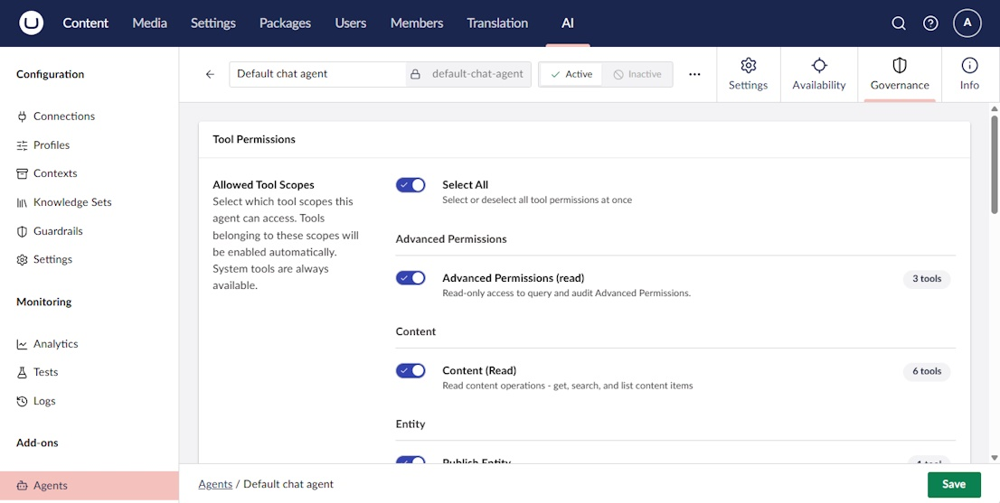

# Advanced Permissions for Umbraco — AI Copilot Tools

Let editors ask the Umbraco backoffice copilot who can do what, and why, and get an answer computed by
your actual permission setup instead of guessed by the language model.

[](https://www.nuget.org/packages/Umbraco.Community.AdvancedPermissions.AI) [](https://www.nuget.org/packages/Umbraco.Community.AdvancedPermissions.AI) [](https://github.com/Luuk1983/Umbraco.Community.AdvancedPermissions.AI/blob/main/LICENSE)

---

## Who this is for

This is an optional companion to
[Advanced Permissions for Umbraco](https://github.com/Luuk1983/Umbraco.Community.AdvancedPermissions).
Install it when you use both of these:

- Advanced Permissions for Umbraco, to manage who may do what in your content tree and Library.
- Umbraco AI with its Copilot chat, so there is a copilot in the backoffice for this package to plug into.

If you do not run Umbraco AI, this package has nothing to add. It ships no screens of its own and adds
nothing to the Users section. Everything it does happens inside the copilot chat, and it only reads your
permission setup. It never changes it.

## The problem it solves

Advanced Permissions gives you Allow and Deny entries per user group, each with its own scope, inherited
down the tree — across both the content tree and the Library — with an override for when a user's groups
disagree. That is exactly the control
you want, and it also means a simple question like "why can't I publish this page?" stops having a simple
answer. Working it out means knowing which groups the person is in, what is set where above the node,
how far each of those entries reaches, and whether an override is deciding it.

Today an editor asks an administrator, and the administrator traces it by hand in the Access Viewer. That
costs someone else's time for a question the system can already answer.

It gets worse once a copilot is in the backoffice. An editor will simply ask the chat, and the chat will
answer from general Umbraco knowledge. That answer is confident, fluent, and wrong, because this
package's rules are not Umbraco's built-in rules. A plain Allow does not beat a Deny here. Leaving a
permission blank is not the same as denying it. An override is about disagreeing groups, not about
parents and children.

This package closes both gaps. It gives the copilot a way to ask your permission engine directly, so
editors get a correct answer in plain language without going through an administrator, and the copilot
stops inventing one when it does not know.

## What you can ask

Once it is set up, editors can ask the copilot things like:

**Why is something blocked**

- "Why can't I delete this page?"
- "Why can't Jane delete this page?"
- "Why is this editor read-only?"
- "Why can't I create an Article here?"

**Who can do what**

- "Who can publish here?"
- "What can the Editors group do on this page?"
- "Which document types can I create under News?"

**The Library**

- "Why can't I delete this library item?"
- "Who can update things in this folder?"
- "Which element types can I create in the Library?"
- "Why can't I add this element type?"

**How the permission system works**

- "What is a Priority Override?"
- "What happens if I leave a permission unset?"

**Where to go in the backoffice**

- "How do I change a permission?"
- "Which editor shows me why a user can't publish?"
- "What's the difference between the Permissions Editor and the Access Viewer?"


When the answer is no, editors can also ask what would change it. The copilot works out which permission
changes would genuinely grant the action, by trying each candidate change against the permission engine
and keeping only the ones that actually flip the result. It then describes those changes so an
administrator can make them, cheapest and least far-reaching first. It never makes a change itself, and
it never offers a fix it has not confirmed.

Every answer comes from your own permission setup, together with the reasoning behind it. The model does
not decide anything. It picks the right question to ask, then puts the result into a sentence.

## Requirements

- Umbraco CMS 18.0.0 or newer, on .NET 10. Note that Umbraco AI currently caps its Umbraco dependency
  below 19, so this package cannot be installed on Umbraco 19 until that cap moves.
- [Umbraco AI](https://github.com/umbraco/Umbraco.AI) 18.2.0 or newer on the 18 line (the first release
  with knowledge sets), installed and configured, with a working copilot chat. This package brings the Umbraco AI runtime with it, but not its backoffice
  screens: install the `Umbraco.AI` package for the AI section, and `Umbraco.AI.Agent.Copilot` for the
  chat itself.
- Advanced Permissions for Umbraco 18.3.0 or newer, which arrives automatically as a dependency. The
  18.3.0 floor is what brings the start-node service this package uses, so its answers account for
  start nodes the same way the Access Viewers do.

Using Umbraco 17? Install the 17.x line of this package instead — it is maintained on the `v17/main`
branch and covers the content tree only, since the Library did not exist yet.


## Installation

```bash
dotnet add package Umbraco.Community.AdvancedPermissions.AI
```

There is no setup code to write. Installing the package is not enough on its own, though: you also have
to allow the copilot to use it, which is the next section.

## Setting up Umbraco AI

All of this happens in the backoffice AI section. If you already have a working copilot chat, skip to
step 5, which is the only step specific to this package.

1. **Create a connection.** Pick your provider (OpenAI, Anthropic, and so on) and give it an API key.
   This needs the matching provider package installed, such as `Umbraco.AI.OpenAI` or
   `Umbraco.AI.Anthropic`.
2. **Create a profile.** A profile sets the model to use, along with any guardrails, on top of that
   connection.
3. **Set a default chat profile** in the AI settings, choosing one of the profiles you created.
4. **Set up a default chat agent** for the copilot. Without one there is no chat for these tools to be
   called from.
5. **Allow this package's tools on that agent.** Open the chat agent, go to Governance, and under
   Allowed Tool Scopes tick "Advanced Permissions (read)". All three tools sit under that one scope.



Step 5 is the one people miss. The tools are discovered automatically, so they appear in the list as soon
as you install the package, but until the agent is allowed to call them the copilot will keep answering
permission questions from its own general knowledge. Because it sits under a single scope, that same tick
is also how you take the tools away again, and Umbraco AI's per-user-group governance applies to it like
any other scope.

The package's reference text (how the permission rules work, and which screen to use) needs no step at
all. It ships as an Umbraco AI knowledge set, which Umbraco AI makes available to every agent on its own,
so even a copilot without the scope can explain the rules instead of guessing them.

To confirm it works, open a content node, start a copilot chat and ask "who can publish here?". The
answer should name your real user groups.

## The tools

Three tools are registered, all under the `advanced-permissions:read` scope. The copilot picks between
them; you never call them yourself. The reference text the copilot needs alongside them is not a tool:
see [Built-in knowledge](#built-in-knowledge).

Like the base package's viewers, the tools only let someone with access to the Users section look up
other people's permissions. Without it, an editor can still ask about their own access, but asking about
another user, a user group, or every user group, and running an audit, is refused.

The split falls along two lines. `uap_explain_access` and `uap_explain_library_access` are siblings
because the content tree and the Library are stored and resolved separately, and the Library's arguments
genuinely differ — element-type creation takes no node at all.

### `uap_explain_access`

Answers what the effective permission is at a content node, and why. A `subject` argument chooses whose
access to evaluate: the current user, a specific user, a single user group (including "All Users"), or
every user group at once. An `aspect` argument chooses which dimension: `node` for action permissions
such as edit, delete and publish, or `type-create` for the Insert Options question of which document
types may be created under a node. For `type-create` the `nodeKey` is the parent node. Supply a
`contentTypeKey` to focus one document type, or leave it out for the full roster. Document types that
Umbraco's own allowed-child-types configuration rules out come back as "Not applicable", kept separate
from a permission Deny.

Start nodes are taken into account the same way the base package's Access Viewers do. Umbraco checks them
before any permission, so when the subject's start nodes do not reach the node (or, for `type-create`, the
parent), every result comes back as "Blocked (start nodes)" instead of allowed or denied. The answer keeps
what the permissions alone would give and names the start nodes in effect and who set them. A blocked
answer never carries a suggested fix, because no permission entry can change it. In the all-user-groups
roster, a group whose own start node misses the node keeps its allowed or denied result and is also
flagged, with a note that users combine the start nodes of all their groups, so a member may still reach
the node through another group. A group with no content start node at all, such as the stock "Sensitive
data" group, is listed apart with a shorter note, since it only adds rights to members who reach the node
another way. The All Users group has no start nodes and is never blocked.

Set `suggestFix=true` to get the confirmed fixes described above. The package builds a small,
case-specific set of candidate changes, simulates each one against its own pure resolver, and returns
only those that actually flip the verdict to allowed, ranked least-privileged first: remove the Deny
entry, add an Allow on the node, add an Allow on an ancestor, add a priority-override Allow. This exists
because a language model left to itself will claim a plain Allow entry can beat a Deny entry on the same
node. It cannot, and the simulation throws that suggestion away. Re-resolution runs directly against the
pure resolver on an in-memory copy of the entries, never the cached service, and uses the same set of
user groups the original verdict used. `suggestFix` applies to the node aspect, to the current-user, user
and user-group subjects, and only when a single permission is in focus.

### `uap_explain_library_access`

The Library counterpart. The Library holds reusable items and folders that live outside the content tree,
and because it is stored and resolved separately, an answer from the content tool would simply be about
the wrong thing — which is why this is its own tool rather than another `aspect`. It takes the same four
subjects, the same detail levels and the same `suggestFix`, so anything learned about the content tool
carries over.

Two things differ, both because the Library does. With `aspect=node` the `nodeKey` is a library item or
folder, and some permissions come back as "Not applicable" rather than allowed or denied: Create has no
meaning on a single item, and the item-only actions — Publish, Unpublish, Duplicate, Rollback — do not
apply to a folder itself, only to the items inside it. Those are the hatched N/A cells in the base
package's own editors, and the package reports them as such rather than relaying the raw resolved value,
which would have the copilot announce a Deny that is not really in effect.

With `aspect=element-type-create` there is no node at all. Umbraco supplies no parent when you create an
item in the Library, so that decision is section-wide: pass no `nodeKey`, and optionally an
`elementTypeKey` to focus one type. Element types are creatable by default, so a type with no entries
anywhere reads as allowed and a Deny is what hides one. That only holds for someone who can reach the
Library: a user or user group with no Library start node at all gets "Blocked (start nodes)" for every
type. Right after an upgrade to Umbraco 18 that is every group except Administrators.

Library start nodes apply to `aspect=node` too, exactly as content start nodes do, except that a
permission that is "Not applicable" for that kind of node stays not applicable.

Umbraco AI currently offers the copilot in the Content and Media sections but not in the Library, so
Library questions are asked from another section and the copilot has no Library item in front of it. Name
the item or folder instead: the tool takes a `nodeName` and looks it up. An exact name (ignoring case)
is used directly. When several nodes share the name, or only similar names exist, the copilot gets up to
ten candidates with the folder each sits in, and asks you which one you mean. Someone without access to
the Users section only finds what their Library start nodes let them see, so a name search never reveals
an item Umbraco hides from them.

### `uap_audit_permissions`

Scans stored permission entries for risks and conflicts. A
`scope` argument audits one user group (the default), everything under a node, or the whole
configuration, with an optional minimum-severity filter. A `domain` argument chooses which configuration
to scan: the content tree (the default), the Library tree, the document-type Insert Options, or the
Library element-type create entries. All four are stored separately, so a content audit says nothing
about the Library — ask for each domain you care about. The Library element-type domain is set once for
the whole Library rather than per node, so the subtree scope does not apply to it; the other three do.

Two checks run in every domain: an Allow entry and a Deny entry for the same permission on the same node,
and Priority Override entries. The rest depends on which way the domain defaults. For node permissions
(content and Library) there are two more: a user group able to manage permissions across a node and its
descendants, and All Users *allowed* a write permission across the whole tree. For the two create filters
an Allow grants nothing (they can only narrow), so the one extra check is the mirror image: All Users
*denied* creating a type everywhere, which hides it unless a more specific Allow entry lower down (document
types only) or a Priority Override Allow entry outranks it. Findings in a create-filter domain name the
document type or element type they concern.

The Library domain runs one more check: a user group that has Library Allow entries but no Library start
node, so on its own it gives no Library access and its entries only help members who reach the Library
through another group or their own start node.

Those checks are the entire rule set, so a clean result means they found nothing rather than that the
configuration is correct in general. The whole-configuration scope is best-effort for the three per-node
domains (content, Library and document types): it covers every live node plus the Default permissions row,
so entries left behind on deleted or trashed nodes are not included. For the create filters it enumerates
every user group, so no group's entries are missed; the Library element-type filter has no nodes, so all
of its entries are read.

## Built-in knowledge

Some answers do not depend on anything in your site: how the permission rules work, and which of the
eight permission screens to use. Those are not tools but an Umbraco AI **knowledge set**, "Advanced
Permissions", with two items. The rule the package follows is simple: if an answer depends on live
data it is a tool, and if it does not it is knowledge.

Umbraco AI switches a knowledge set on by itself, for every agent, with nothing to configure. Each item's
name and one-line description are listed for the model in every chat, and the model reads the full text
when a question needs it. The package's own instructions to the copilot point at both items by name, so
it looks them up rather than answering from memory.

The wording comes from the base package's own help documentation, so the copilot explains the model
exactly as the in-product help does.

### Permission concepts

How permissions are stored, how competing entries are resolved, what each scope reaches, what Priority
Override actually is, how the create filters differ, how start nodes come before any permission, how to
change a permission, and that the same machinery governs two separate trees. It exists because the
copilot answered these questions confidently and wrongly when left to its own knowledge.

### Permission editors and viewers

Which of the base package's eight editors and viewers answers a given question, what each one does and
does *not* do, and the exact backoffice navigation.

It is separate from Permission concepts because the two answer different questions, and the base
package's own documentation splits the same way — the permission model did not change between the 17 and
18 lines, but the number of screens doubled. Keeping them apart means "what is a Priority Override?" does
not pay for a tour of the backoffice.

The content leads with the differences rather than eight descriptions, because all eight names are some
combination of "permissions", "access", "editor" and "viewer", and the failure worth preventing is not
that the copilot cannot describe a screen — it is that it confidently describes the wrong one. So it
first gives the three questions that pick a surface (which tree, which mechanism, change it or just see
it), then the three distinctions that separate them, and only then the per-screen detail, where every
entry names the neighbour to use instead.

## Security

- Nothing here writes data. The fix suggestions depend only on the pure resolver, a single read from the
  repository, and a local copy of the entry list. No save or delete path is ever called, and a simulated
  change is never persisted.
- No privilege escalation by design. Answers come from the same resolver the backoffice itself uses, so
  the model cannot invent or grant a permission. It can only report what your engine computes, and a
  suggested fix names only user groups and nodes already present in the reasoning.
- Every tool sits under the `advanced-permissions:read` scope, so Umbraco AI's per-user-group governance
  can allow or deny it like any other tool. The knowledge set is not gated that way: it holds only the
  package's static help text, never anything read from your site.


## Contributing

Issues and pull requests are welcome. See [CONTRIBUTING.md](CONTRIBUTING.md).

## Feedback

Found a bug or have a feature request? Please
[open an issue](https://github.com/Luuk1983/Umbraco.Community.AdvancedPermissions.AI/issues) on GitHub.

## License

Licensed under the [MIT License](LICENSE).
