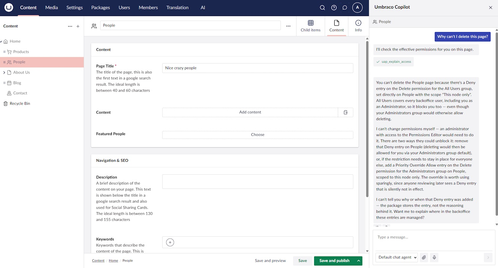

# Advanced Permissions for Umbraco — AI Copilot Tools

Let editors ask the Umbraco backoffice copilot who can do what, and why, and get an answer computed by
your actual permission setup instead of guessed by the language model.

[](https://www.nuget.org/packages/Umbraco.Community.AdvancedPermissions.AI) [](https://www.nuget.org/packages/Umbraco.Community.AdvancedPermissions.AI) [](https://github.com/Luuk1983/Umbraco.Community.AdvancedPermissions.AI/blob/main/LICENSE)

---

## Who this is for

This is an optional companion to
[Advanced Permissions for Umbraco](https://github.com/Luuk1983/Umbraco.Community.AdvancedPermissions).
Install it when you use both of these:

- Advanced Permissions for Umbraco, to manage who may do what in your content tree.
- Umbraco AI with its Copilot chat, so there is a copilot in the backoffice for this package to plug into.

If you do not run Umbraco AI, this package has nothing to add. It ships no screens of its own and adds
nothing to the Users section. Everything it does happens inside the copilot chat, and it only reads your
permission setup. It never changes it.

## The problem it solves

Advanced Permissions gives you Allow and Deny entries per user group, each with its own scope, inherited
down the content tree, with an override for when a user's groups disagree. That is exactly the control
you want, and it also means a simple question like "why can't I publish this page?" stops having a simple
answer. Working it out means knowing which groups the person is in, what is set where above the node,
how far each of those entries reaches, and whether an override is deciding it.

Today an editor asks an administrator, and the administrator traces it by hand in the Access Viewer. That
costs someone else's time for a question the system can already answer.

It gets worse once a copilot is in the backoffice. An editor will simply ask the chat, and the chat will
answer from general Umbraco knowledge. That answer is confident, fluent, and wrong, because this
package's rules are not Umbraco's built-in rules. A plain Allow does not beat a Deny here. Leaving a
permission blank is not the same as denying it. An override is about disagreeing groups, not about
parents and children.

This package closes both gaps. It gives the copilot a way to ask your permission engine directly, so
editors get a correct answer in plain language without going through an administrator, and the copilot
stops inventing one when it does not know.

## What you can ask

Once it is set up, editors can ask the copilot things like:

**Why is something blocked**

- "Why can't I delete this page?"
- "Why can't Jane delete this page?"
- "Why is this editor read-only?"
- "Why can't I create an Article here?"

**Who can do what**

- "Who can publish here?"
- "What can the Editors group do on this page?"
- "Which document types can I create under News?"

**How the permission system works**

- "What is a Priority Override?"
- "What happens if I leave a permission unset?"
- "Why is this page missing from the content tree?"
- "How do I change a permission?"
- "Which screen shows me why someone can't publish?"



When the answer is no, editors can also ask what would change it. The copilot works out which permission
changes would genuinely grant the action, by trying each candidate change against the permission engine
and keeping only the ones that actually flip the result. It then describes those changes so an
administrator can make them, cheapest and least far-reaching first. It never makes a change itself, and
it never offers a fix it has not confirmed.

Every answer comes from your own permission setup, together with the reasoning behind it. The model does
not decide anything. It picks the right question to ask, then puts the result into a sentence.

## Requirements

- Umbraco CMS 17.4.0 or newer, on .NET 10. This floor comes from Umbraco AI.
- [Umbraco AI](https://github.com/umbraco/Umbraco.AI) on the 17 line, installed and configured, with a
  working copilot chat. This package brings the Umbraco AI runtime with it, but not its backoffice
  screens: install the `Umbraco.AI` package for the AI section, and `Umbraco.AI.Agent.Copilot` for the
  chat itself.
- Advanced Permissions for Umbraco 17.5.0 or newer, which arrives automatically as a dependency. 17.5.0
  is the first version that lets the copilot take start nodes into account.


## Installation

```bash
dotnet add package Umbraco.Community.AdvancedPermissions.AI
```

There is no setup code to write. Installing the package is not enough on its own, though: you also have
to allow the copilot to use it, which is the next section.

## Setting up Umbraco AI

All of this happens in the backoffice AI section. If you already have a working copilot chat, skip to
step 5, which is the only step specific to this package.

1. **Create a connection.** Pick your provider (OpenAI, Anthropic, and so on) and give it an API key.
   This needs the matching provider package installed, such as `Umbraco.AI.OpenAI` or
   `Umbraco.AI.Anthropic`.
2. **Create a profile.** A profile sets the model to use, along with any guardrails, on top of that
   connection.
3. **Set a default chat profile** in the AI settings, choosing one of the profiles you created.
4. **Set up a default chat agent** for the copilot. Without one there is no chat for these tools to be
   called from.
5. **Allow this package's tools on that agent.** Open the chat agent, go to Governance, and under
   Allowed Tool Scopes tick "Advanced Permissions (read)". All four tools sit under that one scope.


Step 5 is the one people miss. The tools are discovered automatically, so they appear in the list as soon
as you install the package, but until the agent is allowed to call them the copilot will keep answering
permission questions from its own general knowledge. Because it sits under a single scope, that same tick
is also how you take the tools away again, and Umbraco AI's per-user-group governance applies to it like
any other scope.

To confirm it works, open a content node, start a copilot chat and ask "who can publish here?". The
answer should name your real user groups.

## The tools

Four tools are registered, all under the `advanced-permissions:read` scope. The copilot picks between
them; you never call them yourself.

Like the base package's viewers, the tools only let someone with access to the Users section look up
other people's permissions. Without it, an editor can still ask about their own access, but asking about
another user, a user group, or every user group, and running an audit, is refused.

A user group can be named the way it appears on screen ("Editors") or by its alias, and "All Users" means
the All Users group. A name that matches no user group is refused with the list of real groups, rather
than being answered as a group with no entries.

### `uap_explain_access`

Answers what the effective permission is at a content node, and why. A `subject` argument chooses whose
access to evaluate: the current user, a specific user, a single user group (including "All Users"), or
every user group at once. An `aspect` argument chooses which dimension: `node` for action permissions
such as edit, delete and publish, or `type-create` for the Insert Options question of which document
types may be created under a node. For `type-create` the `nodeKey` is the parent node. Supply a
`contentTypeKey` to focus one document type, or leave it out for the full roster. Document types that
Umbraco's own allowed-child-types configuration rules out come back as "Not applicable", kept separate
from a permission Deny.

Set `suggestFix=true` to get the confirmed fixes described above. The package builds a small,
case-specific set of candidate changes, simulates each one against its own pure resolver, and returns
only those that actually flip the verdict to allowed, ranked least-privileged first: remove the Deny
entry, add an Allow on the node, add an Allow on an ancestor, add a priority-override Allow. This exists
because a language model left to itself will claim a plain Allow entry can beat a Deny entry on the same
node. It cannot, and the simulation throws that suggestion away. Re-resolution runs directly against the
pure resolver on an in-memory copy of the entries, never the cached service, and uses the same set of
user groups the original verdict used. `suggestFix` applies to the node aspect, to the current-user, user
and user-group subjects, and only when a single permission is in focus.

Start nodes are taken into account the same way the base package's Access Viewer does. Umbraco checks them
before any permission, so when the subject's start nodes do not reach the node (or, for `type-create`, the
parent), every result comes back as "Blocked (start nodes)" instead of allowed or denied. The answer keeps
what the permissions alone would give and names the start nodes in effect and who set them. A blocked
answer never carries a suggested fix, because no permission entry can change it. A document type that is
not an allowed child stays "Not applicable". In the all-user-groups roster, a group whose own start node
misses the node keeps its allowed or denied result and is also flagged, with a note that users combine the
start nodes of all their groups, so a member may still reach the node through another group. A group with
no start node at all, such as the stock "Sensitive data" group, is listed apart with a shorter note, since
it only adds rights to members who reach the node another way. The All Users group has no start nodes and
is never blocked.

### `uap_audit_permissions`

Scans stored permission configuration for risks and conflicts. A `domain` argument chooses what to scan:
`content`, the permission entries on the content tree (the default), or `document-types`, the Insert
Options that decide which document types each user group may create where. The two are stored separately,
so each audit says nothing about the other. A `scope` argument audits one user group (the default),
everything under a node, or the whole configuration, with an optional minimum-severity filter.

Two checks run in both domains: an Allow entry and a Deny entry for the same thing on the same node, and
Priority Override entries. The rest depends on the domain, because the two default in opposite directions.
For `content` there are two more: a user group able to manage permissions across a node and its
descendants, and All Users allowed a write permission across the whole site from the root. For
`document-types` there is one more: All Users denied creating a document type across the whole site, which
hides that type everywhere unless a more specific Allow entry exists further down or a Priority
Override Allow entry outranks it; a broad Allow there grants nothing, since Insert Options can only
narrow what Umbraco already offers. Insert Options are analyzed one document type at a time, so two
different types at one node are never reported as a conflict, and every finding names the document type it
concerns. The whole-configuration scope reads every user group's entries, never only the All Users ones.

Those checks are the entire rule set, so a clean result means they found nothing rather than that the
configuration is correct in general. In both domains the whole-configuration scope is best-effort: it
covers every live document node plus the Default permissions row, so entries left behind on deleted or
trashed nodes are not included.

### `uap_explain_concepts`

Takes no arguments and reads nothing. It returns the conceptual reference: how permissions are stored,
how competing entries are resolved, what each scope reaches, what Priority Override actually is, how
Insert Options differ, how start nodes limit what a user can reach (and why a page can be missing from the
tree), and where to change a permission in the backoffice. It exists because the copilot
answered these questions confidently and wrongly when left to its own knowledge. The wording comes from
the base package's own help documentation, so the copilot explains the model exactly as the in-product
help does.

### `uap_explain_editors`

Takes no arguments and reads nothing. It returns a guide to the base package's four screens: the Content
Permissions Editor and Document Type Permissions Editor (under Editors in the Users section) and the Access
Viewer and Insert Options Viewer (under Viewers). It explains how to pick the right one, how an editor
differs from a viewer, how content permissions differ from Insert Options, and for each screen what it does
not do and which one to use instead. It exists because the screen names are easy to mix up, and because
the copilot is told never to describe a menu path from memory.

## Security

- Nothing here writes data. The fix suggestions depend only on the pure resolver, a single read from the
  repository, and a local copy of the entry list. No save or delete path is ever called, and a simulated
  change is never persisted.
- No privilege escalation by design. Answers come from the same resolver the backoffice itself uses, so
  the model cannot invent or grant a permission. It can only report what your engine computes, and a
  suggested fix names only user groups and nodes already present in the reasoning.
- Everything sits under the `advanced-permissions:read` scope, so Umbraco AI's per-user-group governance
  can allow or deny it like any other tool.
- Looking up anyone else's permissions, and auditing, needs access to the Users section, the same rule the
  base package applies to its own viewers. Asking about your own access never does.


## Contributing

Issues and pull requests are welcome. See [CONTRIBUTING.md](CONTRIBUTING.md).

## Feedback

Found a bug or have a feature request? Please
[open an issue](https://github.com/Luuk1983/Umbraco.Community.AdvancedPermissions.AI/issues) on GitHub.

## License

Licensed under the [MIT License](LICENSE).
