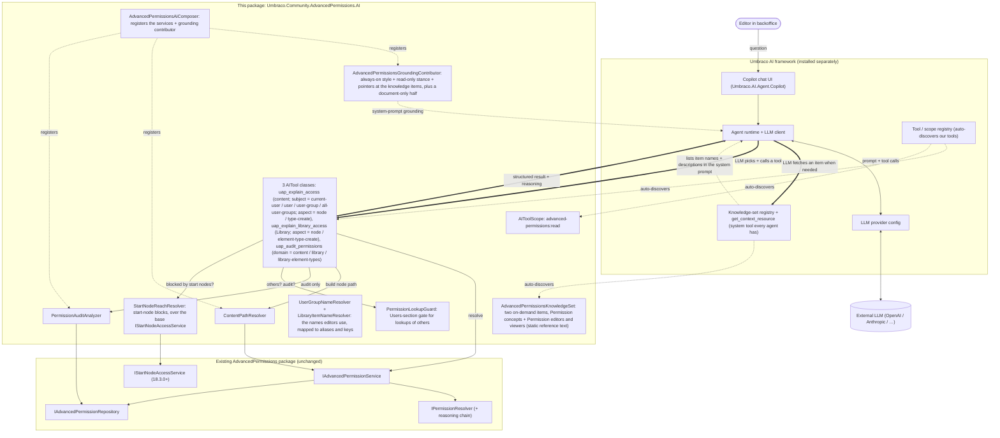

# Architecture

How the AI companion sits between Umbraco AI and the base permission package. These diagrams live here
rather than in the README because NuGet.org renders Mermaid as raw code.

## The three layers



- Umbraco AI, at the top, provides the copilot chat, the agent runtime and the LLM connection.
- This package, in the middle, adds three auto-discovered `[AITool]` classes, a read-only tool scope, an
  auto-discovered knowledge set holding the static reference text (see below),
  helper services (`ContentPathResolver`, `PermissionAuditAnalyzer`, `PermissionPresenter`,
  `StartNodeReachResolver`, `PermissionLookupGuard`, and the two name resolvers that turn a user group's
  or Library node's name into its alias or key) and a runtime-context contributor that grounds the
  copilot. Start nodes are applied here, not by the base resolvers: the resolvers answer from entries
  alone, while Umbraco checks start nodes first, so a node outside them is reported "Blocked (start
  nodes)".
- The base permission package, at the bottom, is unchanged. The tools simply call its
  `IAdvancedPermissionService`.

## A request, end to end

Request flow for *"Why can't Jane delete this page?"*:

```mermaid
sequenceDiagram
    actor E as Editor
    participant C as Umbraco AI Copilot
    participant L as LLM (via provider)
    participant T as uap_explain_access
    participant P as ContentPathResolver
    participant S as IAdvancedPermissionService

    E->>C: "Why can't Jane delete this page?"
    C->>L: prompt + tool catalogue + grounded context (node, user)
    Note over L: Picks uap_explain_access;<br/>fills subject = user, userKey, nodeKey, verb = Delete
    L->>T: invoke(subject: User, userKey, nodeKey, "Umb.Document.Delete")
    T->>P: GetPathFromRoot(nodeKey)
    P-->>T: [rootKey … nodeKey]
    T->>S: ResolveAsync(user, node, path, verb)
    S-->>T: EffectivePermission { IsAllowed: false, reasoning[] }
    T-->>L: structured result (reasoning chain)
    L-->>C: turns the reasoning into plain language
    C-->>E: "Jane can't. The Editors user group has a Deny entry on the Delete permission at /News, and this page inherits it."
```

The LLM never decides a permission. It picks a tool, fills in the arguments, then phrases the
deterministic result the resolver computed.

## The grounding split

`AdvancedPermissionsGroundingContributor` contributes to the copilot's system prompt in two halves:

- Always on (roughly 700 tokens): editor-facing terminology and readability rules, the read-only
  stance, that the package governs two separate trees, and pointers to the "Permission concepts" and
  "Permission editors and viewers" knowledge items. It carries no definitions, only what the knowledge
  cannot deliver, because the style rules have to govern every sentence the copilot writes, including ones
  that paraphrase another tool's output.
- Document conversations only (roughly 300 tokens, appended): tool nudges that presume a focused node,
  the `suggestFix` rules, and the requirement to relay the `GrantedBy` and `Caution` fields.

- Library conversations only (roughly 320 tokens, appended, gated on the `element` / `element-folder`
  entity types): the same discipline pointed at `uap_explain_library_access`, plus the rule that some
  Library permissions are "Not applicable" rather than denied.

The two domain halves are mutually exclusive — they point at different tools for the same question — and
every combination is a strict superset of the always-on half, so no conversation loses grounding to the
split.

The definitions themselves live in the knowledge set, so their cost is paid only when the model fetches
them. The pointer in the always-on half is what makes that safe. The failure it fixes was the model
answering confidently and wrongly from its own assumptions, and a reference is no use if the model never
thinks to open it.

## Tools versus knowledge

If an answer depends on live data it is a tool; if it does not, it is knowledge. The three tools read
permission entries, start nodes and user groups from the site. The reference text never changes from one
site to the next, so it ships as an Umbraco AI knowledge set (`AdvancedPermissionsKnowledgeSet`, Umbraco AI
18.2.0+):

- Umbraco AI discovers it by its `[AIKnowledgeSet]` attribute and turns it on for every chat request on
  the site. There is no composer code, no agent setup, and no tool scope to allow.
- Each item's name and description are listed in the system prompt under "Available On-Demand Context
  Resources". The body is fetched only when the model calls `get_context_resource`, a system tool every
  agent has regardless of its allowed tools.
- So the model still chooses when to fetch. That is why the grounding names both items, and why the
  item descriptions are written to match the questions that need them.
- The two items are rendered from structured records (`ConceptsReference`, `EditorsReference`) so the
  content tests can assert on each section. The item keys (`concepts`, `editors`) seed Umbraco's resource
  ids and never change.

The contributor is deliberately defensive, because Umbraco AI runs contributors on every agent run with
no `try`/`catch` around them. It gates on entity type, is append-only, wraps its whole body in a
catch-all, and contributes only a static string with no I/O.
